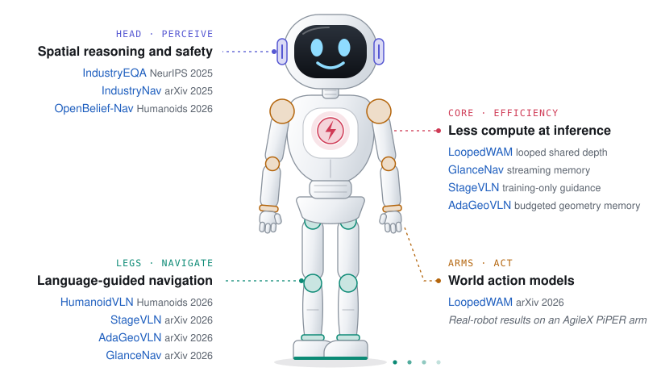

### *Xin chào*, hello! I'm Anh 👋

Ph.D. student in Computer Science at the **University of Central Florida**, advised by [Prof. Yuzhang Shang](https://42shawn.github.io). I work on **efficient embodied AI**: vision-language navigation, world action models and humanoid robots, built to run on the compute a real robot carries.

  <a href="https://anhdao69.github.io/#roadmap">
    <picture>
      <source media="(prefers-color-scheme: dark)" srcset="assets/roadmap-dark.svg">
      
    </picture>
  </a>

| | Papers |
|---|---|
| 🧠 **Perceive** | [IndustryEQA](https://github.com/JackYFL/IndustryEQA) (NeurIPS 2025) · [IndustryNav](https://anhdao69.github.io/IndustryNav_website) · [OpenBelief-Nav](https://openbelief-nav.github.io/) (Humanoids 2026) |
| 🦿 **Navigate** | [HumanoidVLN](https://humanoid-vln.github.io/) (Humanoids 2026) · [StageVLN](https://github.com/StageVLN/StageVLN) · [AdaGeoVLN](https://humanoid-research.github.io/adageovln/) · [GlanceNav](https://github.com/GlanceNav/GlanceNav) |
| 🦾 **Act** | [LoopedWAM](https://github.com/anhdao69/LoopedWAM): looped world action models with test-time depth, tested on a real AgileX PiPER arm |

🔭 **Open to 2027 research internships** in embodied AI, robot learning and efficient models.

[Website](https://anhdao69.github.io) · [Google Scholar](https://scholar.google.com/citations?user=EOD0QkMAAAAJ) · [LinkedIn](https://www.linkedin.com/in/anhdao6) · [anh.dao@ucf.edu](mailto:anh.dao@ucf.edu)
